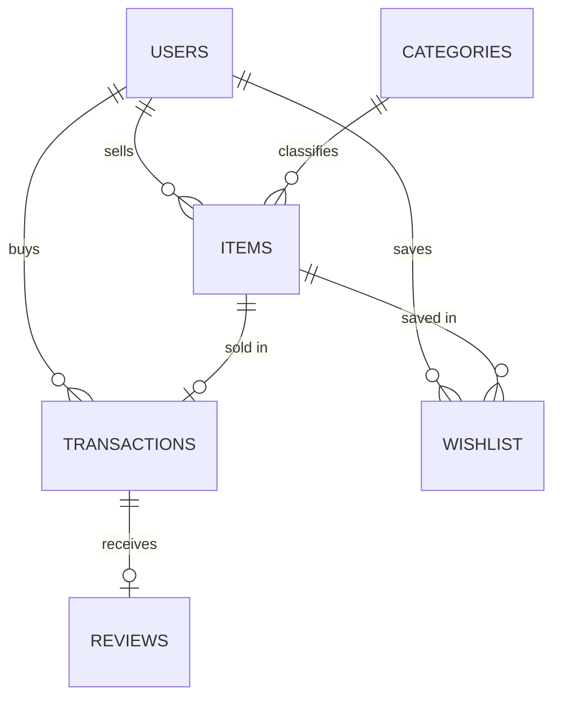

# Campus Marketplace Database

Database system for managing a campus-based marketplace where students can list, buy, and sell used academic and personal items.

**Stack:** MySQL 8 · Node.js + Express (REST API) · HTML/CSS/JS (frontend)

## Run it

1. Install MySQL 8 and make sure the server is running.
2. Put your MySQL username/password in `db/config.js` (or set `DB_USER` / `DB_PASSWORD`).
3. Run:

```bash
npm install
npm run setup   # creates database campus_marketplace from db/schema.sql + db/seed.sql
npm start       # http://localhost:3000
```

Alternative: run `db/schema.sql` and then `db/seed.sql` directly in MySQL Workbench / the `mysql` CLI.

## Phase 1 - Frontend (`public/index.html`)
Marketplace (search + category/price filters), Sell an Item, My Listings (edit price / remove), Wishlist, Transactions, SQL Reports, Schema viewer. The "Acting as" dropdown simulates the logged-in student.

## Phase 2 - Backend (`server.js`) + Database (`db/`)

### ER diagram


### Tables
| Table | Purpose | Key constraints |
|---|---|---|
| users | Students | UNIQUE email, UNIQUE roll_no |
| categories | Item categories | UNIQUE name |
| items | Listings | FK seller, FK category, CHECK price>=0, CHECK condition/status |
| transactions | Completed purchases | item_id UNIQUE (sold once), FK buyer, CHECK payment mode |
| reviews | Rating per transaction | txn_id UNIQUE, CHECK rating 1-5 |
| wishlist | Saved items | Composite PK (user_id, item_id) |

Normalized to **3NF**: seller and category details live in their own tables, and the price paid is stored in `transactions` because a listing's price can change later.

### DBMS features used
- **Constraints:** PK, FK (CASCADE / RESTRICT), UNIQUE, NOT NULL, CHECK, DEFAULT
- **Triggers:** `trg_validate_purchase` (blocks buying an unavailable item or your own item), `trg_mark_sold` (marks item Sold and clears wishlists)
- **Views:** `v_item_details`, `v_seller_stats`
- **Indexes** on seller, category, status, buyer
- **Transactions:** a purchase runs inside `START TRANSACTION` / `COMMIT` with a `SELECT ... FOR UPDATE` row lock (atomic)
- **Queries:** JOINs, GROUP BY / HAVING, correlated subquery, NOT EXISTS, window function (RANK). See the *SQL Reports* tab.

### REST API
| Method | Endpoint | Description |
|---|---|---|
| GET/POST | /api/users | List / register student |
| GET | /api/categories | Categories |
| GET/POST | /api/items | Search + filter / create listing |
| GET/PUT/DELETE | /api/items/:id | View / edit / remove listing |
| GET/POST | /api/transactions | History / buy an item |
| POST | /api/reviews | Review a transaction |
| GET/POST | /api/wishlist | Wishlist |
| GET | /api/stats, /api/reports/:key, /api/schema | Dashboard, SQL reports, schema |
