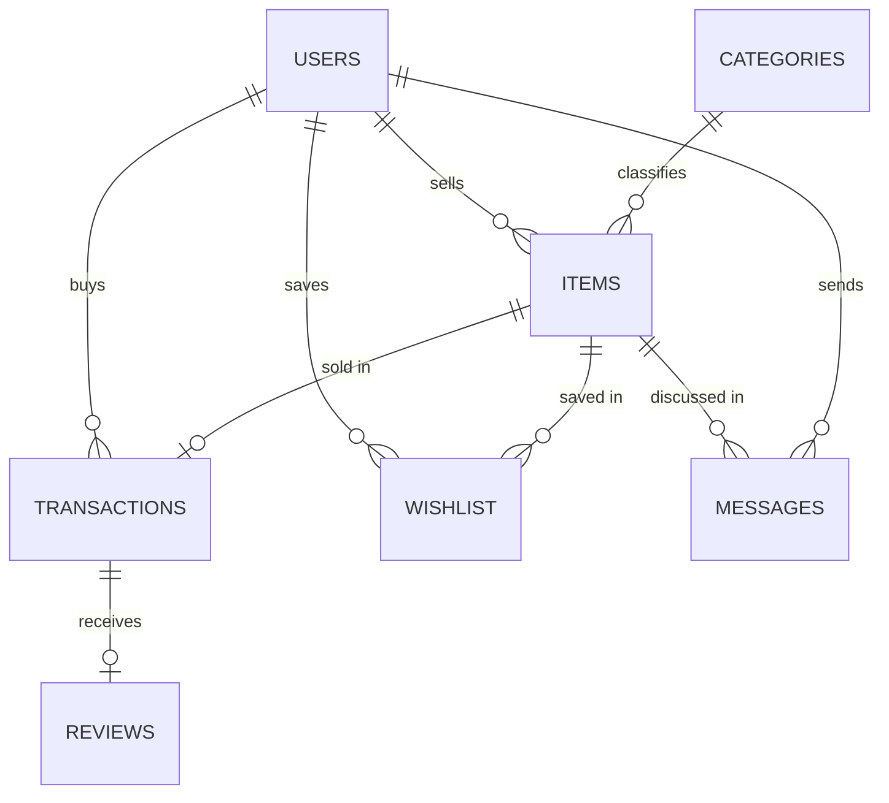

# UniOlx

*Snag it. Flip it. Repeat.*

A full-stack marketplace where students sign up, list, buy and sell used items, chat with sellers and leave reviews.

**Stack:** MySQL 8 · Node.js + Express (REST API) · bcrypt + JWT cookie auth · HTML/CSS/JS frontend

## Run it
1. Install MySQL 8 and start the server.
2. Put your MySQL username/password in `db/config.js` (or set `DB_USER` / `DB_PASSWORD`).
3. Run:
```bash
npm install
npm run setup   # creates the database, tables, seed data and demo passwords (WARNING: drops campus_marketplace first)
npm start       # http://localhost:3000
```
Set `JWT_SECRET` to a long random string for stable logins across restarts (a random one is generated otherwise).

**Demo logins** (password `password123`): `dev@campus.edu` (admin), `yash@campus.edu`, `aryan@campus.edu`, `karan@campus.edu`, `sneha@campus.edu`, `aman@campus.edu`.
Passwords are hashed by `npm run setup`; if you load `schema.sql`/`seed.sql` by hand, seeded users cannot log in until you run setup (or just sign up with a new account).

## Features
- **Sign up / log in / log out**: bcrypt-hashed passwords, 7-day JWT in an httpOnly cookie, login rate limiting
- **Marketplace**: search, category chips, price filter, sorting, results bar, loading placeholders, listing photos (upload from your device)
- **Listing pop-up**: click any card for the full description, seller info (rating, items sold) and quick Buy / Chat / Save
- **Sell**: create listings; **My Listings**: edit or remove your own
- **Buy**: atomic purchase (row lock + triggers), choose Cash / UPI / Card
- **Wishlist**: add and remove (cleared automatically when an item sells)
- **Messages**: ask a seller about a listing; sellers reply to people who contacted them
- **Orders**: your purchases and sales; buyers leave a 1-5 star review
- **Profile**: activity stats (listed, sold, earned, rating, bought), edit details, change password, show/hide password fields
- **Mobile**: bottom navigation bar and compact top bar
- **Admin** (role `admin`): view all users, remove any listing
- **Reports** tab (admins only): sales and listing insights; SQL is never shown in the browser

## Database

| Table | Purpose | Key constraints |
|---|---|---|
| users | Accounts | UNIQUE email, UNIQUE roll_no, password_hash, role ENUM |
| categories | Item categories | UNIQUE name |
| items | Listings | FK seller, FK category, CHECK price>=0, ENUM condition/status |
| transactions | Completed purchases | item_id UNIQUE (sold once), FK buyer |
| reviews | Rating per transaction | txn_id UNIQUE, CHECK rating 1-5 |
| wishlist | Saved items | Composite PK (user_id, item_id) |
| messages | Buyer-seller chat per listing | FK item, sender, receiver |

Normalized to 3NF. Triggers `trg_validate_purchase` and `trg_mark_sold`, views `v_item_details` and `v_seller_stats`, indexes, and `START TRANSACTION` + `SELECT ... FOR UPDATE` purchases.

## REST API (all `/api/*` except signup/login need a logged-in session)
| Method | Endpoint | Description |
|---|---|---|
| POST | /api/auth/signup, /login, /logout | Account + session |
| GET | /api/auth/me | Current user |
| PUT | /api/me, /api/me/password | Update profile / password |
| GET | /api/categories | Categories |
| POST | /api/upload | Upload a listing photo (JPG/PNG/WEBP/GIF, max 3 MB) |
| GET/POST | /api/items | Search, filter, sort / create listing |
| GET/PUT/DELETE | /api/items/:id | View / edit / remove (owner; admin may remove) |
| GET/POST | /api/transactions | Your deals (admin: all) / buy an item |
| POST | /api/reviews | Review a purchase (buyer only) |
| GET/POST/DELETE | /api/wishlist[/:itemId] | Your wishlist |
| GET/POST | /api/messages | Your conversations / send a message |
| GET | /api/admin/users | Admin only |
| GET | /api/stats | Dashboard numbers |
| GET | /api/reports, /api/reports/:key | Admin-only report results (no SQL returned) |

## Production notes
Run behind HTTPS with `NODE_ENV=production` (makes the cookie `secure`), set `JWT_SECRET`, and create a dedicated MySQL user instead of `root`.

Uploaded photos are saved in the `uploads/` folder (created automatically). Back it up together with the database, and keep it on persistent storage if you deploy.
